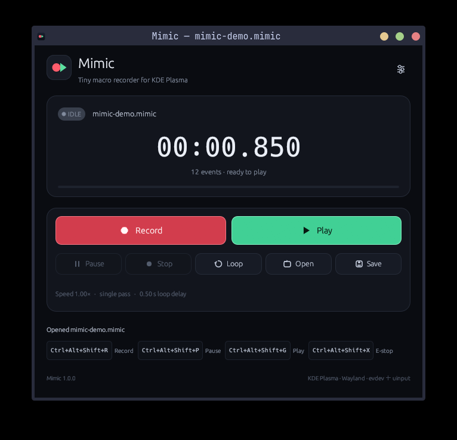

# Mimic

**A compact, native TinyTask alternative for KDE Plasma 6 on Wayland.**

Mimic records keyboard and mouse input, preserves timing, and replays macros
with pause, speed control, looping, and save/open support. It is written in Rust
and runs entirely as your desktop user.



## Features

- Records keyboard presses, mouse movement, buttons, and scrolling.
- Pause/resume while recording; paused time is excluded from the macro.
- Timestamp-accurate playback with adjustable speed and infinite or finite loops.
- Saves the absolute cursor start position and restores it before playback, so
  clicks land in the same place each time.
- Flat, unaccelerated virtual pointer output for 1:1 relative mouse movement.
- Loop passes return the pointer to the saved start position.
- Explicitly releases held keys and buttons on pause, stop, and errors.
- KDE global shortcuts, including an emergency stop.
- Versioned, atomic `.mimic` files with crash-recovery snapshots.
- Compact egui interface; no X11 dependency and no privileged GUI process.

## Requirements

- **KDE Plasma 6 on Wayland** with KWin and the standard XDG desktop portals.
  Tested on Arch Linux with Plasma 6.8.2 / KWin 6.8.2.
- KWin's scripting D-Bus interface (enabled by default). Mimic uses it briefly to
  read the cursor position; no additional permission prompt is required.
- Rust 1.92 or newer and a C toolchain to build from source.
- Linux `evdev` and `uinput`.

X11 sessions, GNOME, Sway, touchscreens, and drawing tablets are not supported.

## Install

From the repository root:

```sh
./scripts/install.sh --with-permissions
```

The install script builds the release binary, installs the desktop entry, icon,
MIME type, and user-level udev rule, then asks for `sudo` for the permission
step. Log out of KDE and back in after installation so the device ACLs apply.

To run the steps separately:

```sh
./scripts/install.sh
sudo ./scripts/install-permissions.sh
# then log out and back in
```

Launch **Mimic** from the application menu. The desktop entry is required for
KDE to associate Mimic with its global shortcuts. On first launch, approve the
shortcut dialog shown by KDE.

The GUI never runs as root, and there is no setuid helper or privileged daemon.

## Usage

1. Click **Record**, or press `Ctrl+Alt+Shift+R`.
2. Perform the actions you want to automate.
3. Stop the recording with the same shortcut or the **Stop** button.
4. Click **Play**, or press `Ctrl+Alt+Shift+G`.
5. Use **Pause**, **Loop**, **Open**, and **Save** as needed.

Mimic stores the cursor's exact starting position in each new recording and
returns the pointer there before playback. For exact 1:1 mouse paths, set the
physical mouse to KDE's **Flat** acceleration profile in System Settings →
Input & Output → Mouse. Mimic automatically configures its own virtual pointer
as Flat/unaccelerated.

### Default shortcuts

| Action | Shortcut |
| --- | --- |
| Start/stop recording | `Ctrl+Alt+Shift+R` |
| Pause/resume recording | `Ctrl+Alt+Shift+P` |
| Start/stop playback | `Ctrl+Alt+Shift+G` |
| Emergency stop | `Ctrl+Alt+Shift+X` |

Shortcuts can be changed from **Settings → Configure shortcuts** or in KDE
System Settings.

## Permissions and security

Recording requires read access to `/dev/input/event*`; playback requires
`/dev/uinput`. `scripts/install-permissions.sh` installs a `uaccess` udev rule
that grants access only to the active local session's user. This is narrower
than permanently adding the user to the `input` group.

Read access to input devices can observe all keyboard and pointer input. The
ACL applies to the session user, so any process running as that user could also
read those devices while the rule is installed. Mimic only reads them while
recording.

The cursor-position query uses a temporary KWin script and a private, one-shot
D-Bus service. The script only reads `workspace.cursorPos` and is unloaded
immediately after reporting.

To remove the input permission:

```sh
sudo ./scripts/uninstall-permissions.sh
```

## Limitations

- Exact path reproduction assumes the same monitor layout and a Flat pointer
  acceleration profile. With Adaptive acceleration, recorded raw movement does
  not match the accelerated on-screen curve.
- Recordings created by older Mimic versions without a saved `pointer_start`
  field play relative to the current cursor. Re-record them to enable exact
  start positioning.
- Touchscreens and drawing tablets are not recorded.
- Key auto-repeat is not replayed as synthetic repeats; the compositor generates
  repeats from a held key using the current KDE repeat settings.
- Global shortcuts and the file chooser use KDE's XDG portals.

## Uninstall

```sh
./scripts/uninstall.sh
sudo ./scripts/uninstall-permissions.sh
```

Your `.mimic` recordings, settings, and recovery state are kept.
Remove those manually if desired.

## Development

The source is split into four layers:

- `src/core` — recording model, validation, storage, settings, errors
- `src/input` — evdev capture and uinput playback
- `src/platform` — KWin cursor query and global-shortcut portal integration
- `src/ui` — egui app, controller, theme, and reusable widgets

```sh
cargo fmt --check
cargo clippy --all-targets -- -D warnings
cargo test
cargo run --release
```

The virtual-device integration test is ignored by default because it creates a
system input device:

```sh
cargo test playback::tests::can_create_virtual_device -- --ignored
```

## License

MIT. See [LICENSE](LICENSE).
